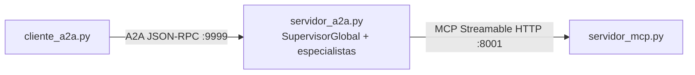

# Laboratorio 6 — Evals

Agentes conversacionales con búsqueda de FAQs sobre una base de conocimientos vectorial (pgvector), consulta de clima (Open-Meteo) y agendamiento de citas de salto, usando Groq como proveedor de LLM. Incluye tres arquitecturas de orquestación multiagente (centralizada, jerárquica, decentralizada) construidas con el [`openai-agents` SDK](https://openai.github.io/openai-agents-python/) apuntando al endpoint compatible con OpenAI de Groq.

## Estructura del proyecto

| Ruta | Contenido |
| --- | --- |
| `src/` | Código fuente: agentes y `common/` (lógica de integración compartida) |
| `data/` | Corpus de FAQs |
| `db/` | Esquema inicial de la base de datos (`init.sql`) |
| `docs/` | Diagramas de arquitectura y PDF de respuestas |
| `demo/` | Video de demostración |
| `compose.yaml` | Definición de PostgreSQL + pgvector |

## Requisitos

- [uv](https://docs.astral.sh/uv/)
- Docker o Podman
- API Key de Groq

## Configuración

Crear un archivo `.env` en la raíz del proyecto utilizando, como referencia:

```env
GROQ_API_KEY=
DB_NAME=laboratorio4_agents
DB_USER=postgres
DB_PASSWORD=postgres
```

Levantar PostgreSQL + pgvector con Docker:

```sh
docker compose up -d
```

Instalar las dependencias del proyecto (`uv` crea el entorno virtual automáticamente):

```sh
uv sync
```

## Cargar la base de conocimientos

Con PostgreSQL activo:

```sh
uv run src/lab4_carga.py
```

## Ejecutar el agente (FAQs)

```sh
uv run src/lab4_agente.py
```

Para salir, escribir `Bye`.

## Ejecutar los agentes multiagente (FAQs + clima + citas)

Cada programa resuelve el mismo problema (FAQs, consulta de clima y agendamiento de citas) con una arquitectura de orquestación distinta. Ver `docs/architecture.md` para el diagrama de cada una y `docs/respuestas.pdf` para el análisis comparativo.

```sh
uv run src/agente_centralizado.py
uv run src/agente_jerarquico.py
uv run src/agente_decentralizado.py
```

Para salir, escribir `Bye`.

## MCP + A2A

Las herramientas (`buscar_faq`, `consultar_clima`, `calendarizar_cita`) se exponen en un servidor MCP con transporte Streamable HTTP, y el sistema multiagente jerárquico se expone como un solo agente A2A (con una skill por funcionalidad) cuyos especialistas consumen esas herramientas vía MCP. La terminal es un cliente A2A.



Con PostgreSQL activo y la base de conocimientos cargada, en tres terminales (en este orden):

```sh
uv run src/servidor_mcp.py   # http://127.0.0.1:8001/mcp
uv run src/servidor_a2a.py   # http://127.0.0.1:9999 (Agent Card en /.well-known/agent-card.json)
uv run src/cliente_a2a.py
```

Variables opcionales: `MCP_URL`, `A2A_HOST`, `A2A_PORT` (servidor A2A) y `A2A_URL` (cliente).

## Evals (promptfoo)

Los evals se ejecutan sobre el agente jerárquico (la arquitectura elegida como la mejor en la hoja anterior) y cubren ambas funcionalidades (FAQs y citas) con aserciones de:

- **Factuality**: `factuality`, calificado por `groq:openai/gpt-oss-120b`.
- **Determinísticas**: `contains`, `icontains`, `regex`.
- **Latencia**: `latency` (< 30 s por consulta).
- **Tool execution**: aserciones `javascript` (`evals/herramientas.js`) que verifican qué herramientas se ejecutaron y con qué argumentos.

| Archivo | Contenido |
| --- | --- |
| `evals/promptfooconfig.yaml` | Configuración y casos de FAQs |
| `evals/tests_citas.py` | Casos de citas (fechas relativas a hoy, resultado esperado según el pronóstico real) |
| `evals/provider.py` | Provider que ejecuta el agente y registra las herramientas llamadas |
| `evals/reporte.html` | Reporte generado por promptfoo |

Requiere Node.js 20+ (`promptfoo@0.120` es la última versión compatible con Node 20). Con PostgreSQL activo y la base de conocimientos cargada:

```sh
PROMPTFOO_PYTHON=.venv/bin/python npx promptfoo@0.120 eval -c evals/promptfooconfig.yaml --no-cache -o evals/reporte.html
```

`--no-cache` es necesario para que la aserción de latencia mida tiempos reales. Para explorar los resultados en el navegador: `npx promptfoo@0.120 view`.
